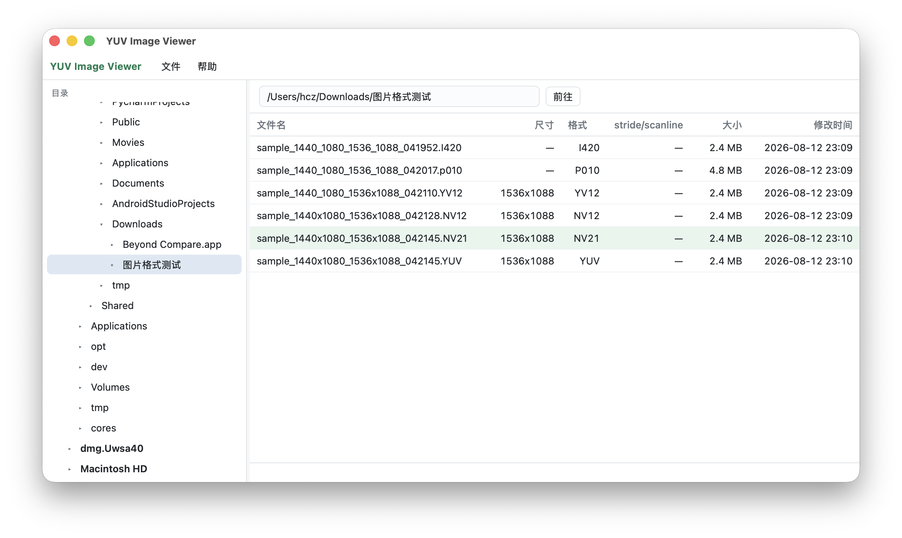
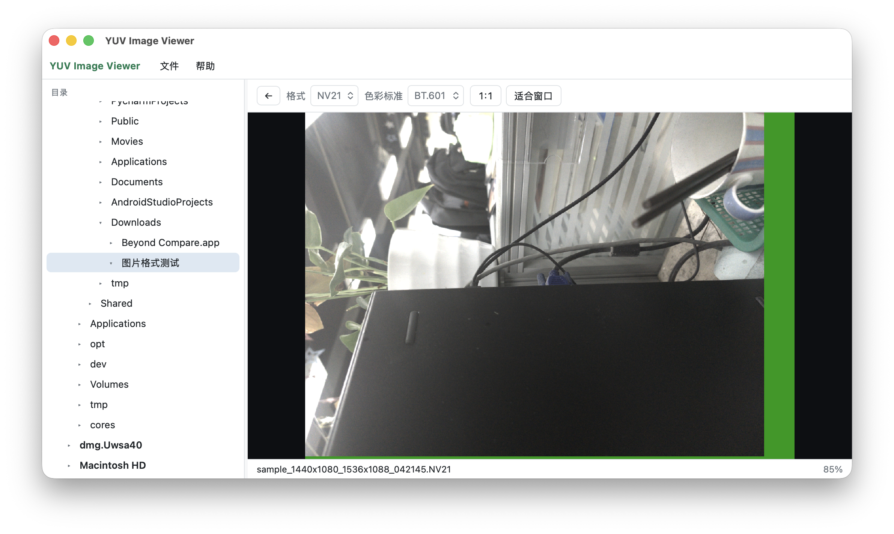
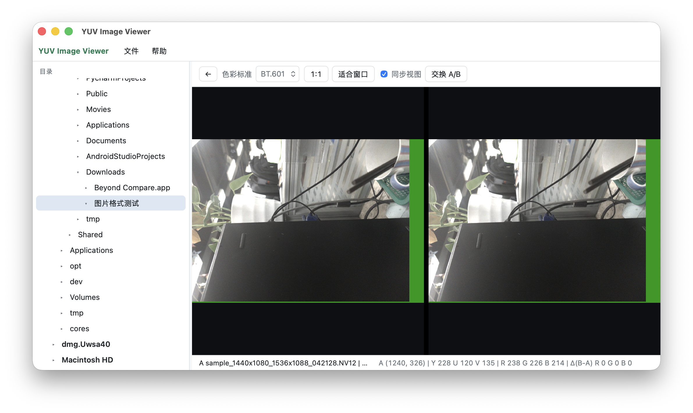

# YUV Image Viewer

一个用来看 **YUV 格式图像** 的本地查看器。主要用来查看手机端 camera 产生的 YUV 图像，查看的是**单张图像**，而非连续的视频帧**。

基于 Tauri 2 + 系统 WebView + WebGL2 的跨平台本地 YUV 图像查看器，支持 Windows、macOS 与 Ubuntu。

当前版本：`0.4.0`

界面概览







## 功能

- 左侧「此电脑」目录树与地址栏，按需展开
- 六列文件列表：文件名、尺寸、格式、stride/scanline、大小、修改时间
- 自然排序，`Ctrl`/`Cmd` 多选，`Shift` 连选
- 单图查看：缩放、平移、适应窗口、1:1、方向键翻图、像素格式切换
- 导出为 JPG：按原图分辨率导出，可选质量，支持单图、对比 A/B 以及文件列表中选中的文件
- 双图对比：同步/独立视图、A/B 交换、YUV/RGB 差值读数
- 拖放文件或目录、命令行路径启动、单实例路径转发
- 大文件（>128 MB）加载确认，加载提示延迟 500 ms
- 相邻图片预取（最多 4 张，单文件 32 MB，总量 96 MB）
- 配置持久化：上次目录、最近目录、窗口几何、侧栏宽度、排序、色彩标准
- 手动规格缓存：按文件路径 + 大小/修改时间校验，命中后自动套用；可在「文件 → 图片规格缓存…」查看与清除
- 文件名规格解析 → 字节数推测 → 手动规格三级回退

## 支持格式

| 扩展名     | 格式   | 说明                |
| ------- | ---- | ----------------- |
| `.nv12` | NV12 | Y + 交错 UV         |
| `.nv21` | NV21 | Y + 交错 VU         |
| `.i420` | I420 | Y + U + V 三平面     |
| `.yv12` | YV12 | Y + V + U 三平面     |
| `.p010` | P010 | 10-bit，支持高/低位对齐检测，无法判断时默认按高位对齐 |
| `.yuv`  | 待选择  | 由用户选择具体格式         |

扩展名不区分大小写。仅读取第一帧；仅支持 BT.601 / BT.709 的 Full range。

## 技术栈

- Tauri 2（Rust 2021）
- TypeScript 5.9（`strict`）
- esbuild 打包前端为单个 IIFE
- 原生 DOM + WebGL2 渲染（R8 / RG8 / RGBA8，`UNPACK_ALIGNMENT=1`，NEAREST）
- Node 22 `node:test` + Rust 内置测试

## 目录结构

```text
app/web/           前端控制器与界面（组合根 boot.ts）
app/src-tauri/     Rust 宿主、IPC、配置、单实例、平台实现
common/            与 DOM/Tauri 无关的纯逻辑
webview/           WebGL2 渲染、视口、着色器、读数
scripts/           构建、打包、测试图生成、版本校验
test/              Node 纯逻辑测试
packaging/         Linux 桌面文件与 MIME 定义
.github/workflows/ Windows / macOS / Ubuntu CI
```

关键入口：[boot.ts](app/web/boot.ts)、[lib.rs](app/src-tauri/src/lib.rs)、[renderer.ts](webview/renderer.ts)。

## 环境要求

- Node.js >= 22
- Rust stable（`rustup`）
- Windows：MSVC 工具链、WebView2 Runtime
- macOS：Xcode Command Line Tools（Tauri 使用 WKWebView）
- Ubuntu 22.04+：

```bash
sudo apt install build-essential libwebkit2gtk-4.1-dev libgtk-3-dev \
  libxdo-dev libayatana-appindicator3-dev librsvg2-dev libssl-dev
```

## 开发

```bash
npm install
npm run app:dev      # 构建前端并启动 Tauri 开发窗口
```

常用命令：

```bash
npm run compile      # TypeScript 类型检查与编译
npm test             # 编译并运行 Node 测试
npm run app:build    # 仅构建前端到 app/dist
npm run check:version # 校验 package.json / Cargo.toml / tauri.conf.json 版本一致
```

## 打包

```bash
npm run app:package            # 构建前端并执行 tauri build
./scripts/build-macos.sh       # macOS .app / .dmg
./scripts/build-linux.sh       # Linux AppImage / deb
./scripts/build-windows.ps1 -Zip # Windows 绿色 zip
```

产物默认位于 `app/src-tauri/target/release/bundle/`。macOS 发布到其他机器需要 Apple 开发者账号签名与公证。

## 配置位置

| 平台      | 位置                                                                         | `store_location`  |
| ------- | -------------------------------------------------------------------------- | ----------------- |
| Windows | exe 同目录 `config.json`，不可写时回退 `%APPDATA%`                                   | `exe` / `appdata` |
| macOS   | `~/Library/Application Support/com.houchengzhi.yuvimageviewer/config.json` | `appdata`         |
| Ubuntu  | `$XDG_CONFIG_HOME/com.houchengzhi.yuvimageviewer/config.json`              | `appdata`         |

配置使用临时文件 + `fsync` + 原子替换写入。规格缓存保存在同一目录的 `spec-cache.json`，同样采用原子替换并串行写入。

## 测试

- Node：104 项纯逻辑测试（路径策略、规格解析、规格缓存、状态机、选择、视口、采样等）
- Rust：8 项单元测试（CLI、配置、路径、待处理队列）
- CI：`windows-latest` / `macos-14` / `ubuntu-22.04` 矩阵执行编译、测试与构建

## 已知限制

- 只读取第一帧，仅支持 Full range
- 最多同时对比两张图，且必须位于同一目录
- 不递归列出子目录中的 YUV 文件，不生成缩略图
- macOS 路径默认按大小写不敏感处理
- Linux 个别合成器存在 WebGL2 整窗白屏风险，已通过 glProbe 实际绘制检测并提示
- Windows 绿色分发不内置 WebView2 Runtime

## 开发指南

跨平台设计与实施细节见 [开发指南](projects_yuv-viewer-windows_docs_cross-platform-development-guide.md)。
